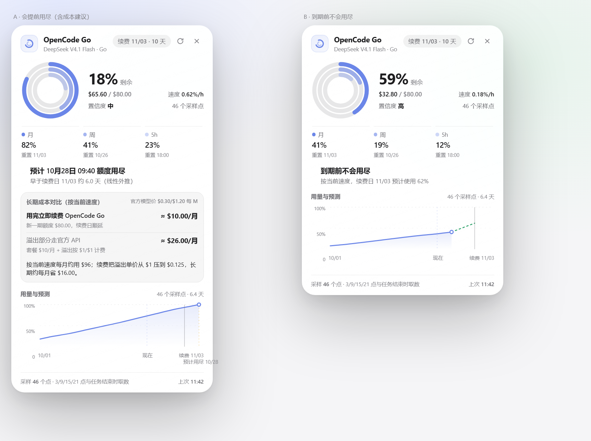
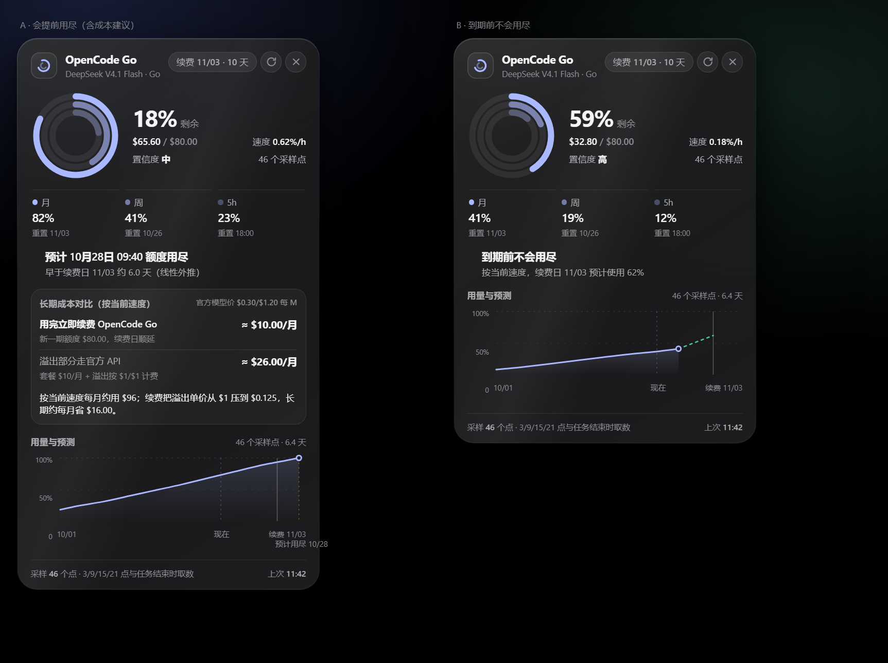
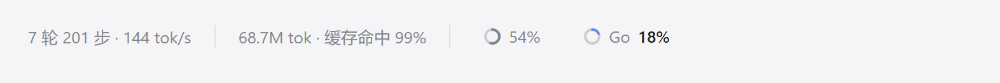

<h1 align="center">dsh-opencode-go-eta</h1>

<p align="center"><b>A quota forecast widget for OpenCode Go inside DeepSeek Harness — it tells you <i>when</i> the monthly allowance runs out, and whether that happens before the renewal date.</b></p>

<p align="center">
  <a href="LICENSE"></a>
  <a href="https://github.com/deepseek-ai/deepseek-harness"></a>
  <a href="package.json">= 22"></a>
  <a href="test"></a>
</p>

<p align="center"><b>English</b> · <a href="README.zh-CN.md">简体中文</a></p>

<p align="center">
  
</p>

<details>
<summary>Dark theme</summary>

<p align="center">
  
</p>
</details>

<h2 align="center">Composer dock</h2>

<p align="center">
  
</p>

<p align="center"><sub>The shipped context ring (54%) and the Go capsule (18%) share the same 14 px / 2 px specification; the capsule stays a text-only trigger, expanding nothing until clicked.</sub></p>

## Why

OpenCode Go is a flat monthly subscription, but its console only shows *used percentages* and a reset time.
It does not tell you whether your current pace will exhaust the allowance before the renewal date — the one
question that decides whether you need to top up, renew early, or switch to the pay-as-you-go API for the rest
of the period.

This plugin keeps a small local history of the official quota readings and answers that question in the
composer dock. It never reads your session logs: the Go allowance is account-wide, so only the official
percentage sees usage from every client.

## Features

- **Projected exhaustion time** — a reset-aware Theil–Sen fit over the recorded quota samples gives an ETA per window, with a confidence tier. No guessing from a single reading.
- **Renewal-date comparison** — says plainly whether the monthly allowance will run out *before* the renewal date, or leave headroom until then.
- **Long-run cost advice** — when the quota will run out early, it compares two steady-state policies: renewing OpenCode Go (a prepayment of the next period, unit cost `planPrice ÷ allowance` per $1 of usage, about $0.125) versus paying the overflow on the official API ($1 per $1). Renewal is recommended unless the new allowance would largely expire unused.
- **Merged usage & forecast chart** — history, projection, “now”, ETA and renewal markers on one time axis, with a 0–100 % axis.
- **Native composer dock capsule** — the 14 px / 2 px ring matches the shipped context meter, so both rings read as peers; the card itself is a liquid-glass panel that dims its highlight layers in dark mode.
- **Per-model allowance** — Go's monthly limit is *per model* (DeepSeek V4.1 Flash: $80 on Go, $160 on Go Plus; Kimi K3: $15). The card shows the model and its allowance, while percentages stay authoritative from the console.
- **No polling storms** — samples at four local anchors a day, on task ends, on start-up and on demand.

## Install

Requires DeepSeek Harness 0.2.x (Desktop or Web profile) and Node.js ≥ 22.

```powershell
# from GitHub
dsh plugin --profile desktop add github:HugoOu/dsh-opencode-go-eta

# or from a local checkout
dsh plugin --profile desktop add link:C:\path\to\dsh-opencode-go-eta
```

Restart DSH completely after installing. The capsule appears below the composer; click it for the card.

> The plugin row is a bundle patch: `dsh plugin add` appends `dsh-opencode-go-eta` to
> `dsh.profile.bundles` automatically, and the bundled `cordis.patch.yml` inserts the host row.

## Configuration

Add to your profile's `cordis.patch.yml` to override the defaults:

```yaml
- id: opencode-go-eta
  name: dsh-opencode-go-eta
  config:
    apiKeyRef: OPENCODE_GO_API_KEY   # credential reference, not the key itself
    anchors: [3, 9, 15, 21]          # local hours; [] disables timed sampling
    sampleIntervalMs: 1200000        # minimum gap between implicit samples
    staleAfterMs: 2700000            # a read this old triggers a fresh sample
    retentionDays: 45
    planName: Go                     # shown in the card
    planPriceUsd: 10                 # price of one period, used by the advice
    modelLabel: DeepSeek V4.1 Flash
    modelAllowancesUsd:
      deepseek-v4.1-flash: 80        # Go table; use 160 for Go Plus
    pricingModel: deepseek-v4.1-flash
    pricingUrl: https://models.dev/api.json
    pricingTtlMs: 43200000
```

The API key is resolved through the Harness credentials service (`OPENCODE_GO_API_KEY`);
it never reaches the browser.

## How it works

| Stage | Behaviour |
| --- | --- |
| Sampling | `GET /zen/go/v1/usage` (percentages + resets) and `GET /console/api/go/status` (meters, period start/end) — at 03/09/15/21 local, on `turn/end`, at start-up, and on demand. |
| History | Samples are kept for 45 days in `$DSH_HOME/opencode-go-eta/samples.json` (atomic writes). |
| Projection | Samples from before the last reset are cut; the Theil–Sen slope of the current cycle gives the ETA. Fewer than 3 points or a span under 6 h is reported as *insufficient samples*. |
| Verdict | ETA is compared with the window reset and the subscription's `endsAt`: *before expiry*, *after expiry*, *safe within the cycle*. |
| Advice | Two steady-state policies: **renew** prices every $1 of usage at `planPriceUsd ÷ allowance` (≈ $0.125), **API overflow** costs $1 per $1 on top of the plan. The monthly costs are compared; renewal is recommended unless expected usage is below one period's price. Official model prices come from models.dev (12 h cache) for display only. |

The console meter is a plan-credit cap (observed $60), while the official Go table lists a per-model
monthly allowance (DeepSeek V4.1 Flash: $80). Percentages always follow the console; money follows the
model allowance so the two never contradict each other silently.

## Development

```bash
node test/projection.test.mjs   # 10 pure-math tests: slope, reset cutting, verdicts
node test/host.test.mjs         # 2 host tests: stubbed fetch, route payload
node test/client.test.mjs       # 4 client tests: slot registration, render, fetch
```

No network or real key is needed. `preview.html` reproduces the shipped styles with mock data
(`#shot` hides the page chrome; `#shot-dark` renders the dark theme).

## Limitations

- `/console/api/go/status` is an internal console endpoint; if it changes, the card falls back to percentages only.
- Projections are linear extrapolations from your own sampling history, not vendor forecasts.
- Cost advice assumes the quota-meter value and the official list price share the same scale; the token estimate is an approximation.
- The plugin stores no prompts or session data — only quota readings and the pricing cache.

## License

[MIT](LICENSE) © 2026 HugoOu

